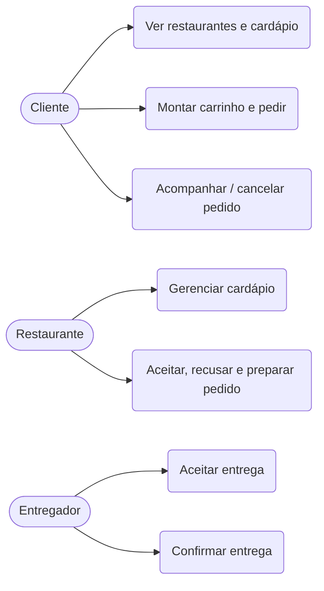
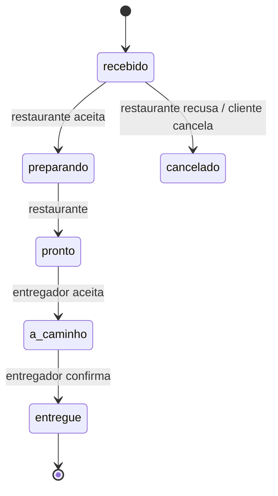
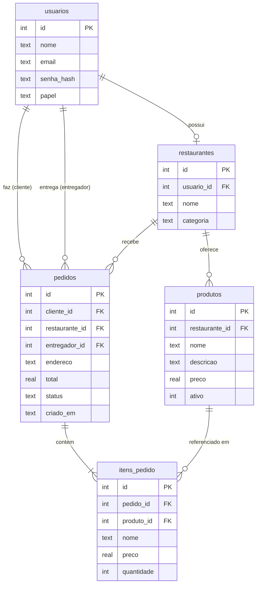

# Documentação — EntregaFácil

Autor: Thiago Bortoleto Xavier · RGM 41142969

## 1. Visão geral
Aplicativo de entrega de comida para uma empresa, desenvolvido com metodologia ágil (Scrum). Ele conecta três perfis: clientes que pedem, restaurantes que preparam e entregadores que levam.

**Objetivo (da PIT I):** adotar metodologias ágeis para melhorar eficiência, qualidade e adaptabilidade, com entrega contínua de valor ao cliente.

## 2. Metodologia (Scrum)
- **Papéis:** Product Owner (define prioridades), Scrum Master (remove impedimentos), time de desenvolvimento.
- **Cerimônias:** planejamento da sprint, daily stand-up, revisão e retrospectiva.
- **Artefatos:** Product Backlog, Sprint Backlog, incremento funcional.
- **Ferramentas:** Trello/GitHub Projects (Kanban), GitHub (código), Jira (opcional).

### Product Backlog (priorizado)
| # | História de usuário | Prioridade | Sprint |
|---|---|---|---|
| 1 | Como usuário, quero me cadastrar e entrar, para acessar o app | Alta | 1 |
| 2 | Como cliente, quero ver restaurantes e cardápios | Alta | 1 |
| 3 | Como restaurante, quero gerenciar meu cardápio | Alta | 1 |
| 4 | Como cliente, quero montar o carrinho e finalizar o pedido | Alta | 2 |
| 5 | Como restaurante, quero receber o pedido e atualizar o status | Alta | 2 |
| 6 | Como entregador, quero aceitar e concluir entregas | Alta | 3 |
| 7 | Como cliente, quero acompanhar o status e cancelar enquanto "recebido" | Média | 3 |
| 8 | Como usuário, quero instalar o app no celular (PWA) | Média | 3 |
| 9 | Pagamento online real, avaliações, mapa e rastreio | Baixa | Futuro |

### Sprints
- **Sprint 1:** autenticação, restaurantes e cardápio.
- **Sprint 2:** carrinho, pedido e fluxo do restaurante.
- **Sprint 3:** entregador, PWA, testes automatizados e deploy.

## 3. Requisitos
**Funcionais**
- RF01 Cadastro e login com 3 perfis (cliente, restaurante, entregador).
- RF02 Listar restaurantes e cardápios.
- RF03 Restaurante cria e remove produtos.
- RF04 Cliente cria pedido com itens, endereço e total calculado no servidor.
- RF05 Restaurante aceita, recusa e marca o pedido como pronto.
- RF06 Entregador aceita pedidos prontos e confirma a entrega.
- RF07 Cliente acompanha o status e cancela pedido recebido.

**Não funcionais**
- RNF01 Senhas com hash (bcrypt) e autenticação JWT (12 h).
- RNF02 Interface responsiva e instalável (PWA).
- RNF03 Autorização por papel e por dono do recurso.
- RNF04 Atualização de status a cada 5 s.

## 4. Casos de uso

## 5. Status do pedido

## 6. Modelo de dados

## 7. Arquitetura
Navegador (PWA) → API REST Express → SQLite. O mesmo servidor Express entrega os arquivos estáticos do PWA e a API em `/api`.

### Endpoints
| Método | Rota | Papel |
|---|---|---|
| POST | `/api/auth/register`, `/api/auth/login` | público |
| GET | `/api/restaurantes`, `/api/restaurantes/:id/produtos` | público |
| POST/DELETE | `/api/produtos`, `/api/produtos/:id` | restaurante |
| POST | `/api/pedidos` | cliente |
| GET | `/api/pedidos` | todos (filtrado por papel) |
| PATCH | `/api/pedidos/:id/status` | cliente, restaurante, entregador (transições validadas) |

### Segurança
- O preço e o total são recalculados no servidor, nunca vindos do cliente.
- SQL parametrizado, sem concatenação.
- Escape de HTML no front-end contra XSS.
- Aceite de entrega com `UPDATE ... WHERE status='pronto'`, o que evita dois entregadores no mesmo pedido.

## 8. Testes
Automatizados (`npm test`, 7 testes): login inválido, cadastro duplicado, listagens públicas, fluxo completo pedido→entrega, bloqueio entre restaurantes, validações de pedido e permissões do cardápio.

Testes com usuários: tabela de 5 colegas no arquivo `docs/TESTES_E_LAUDO.md`.

## 9. Melhorias futuras
Pagamento real (Pix), WebSocket, mapa e rastreio, avaliações, banco PostgreSQL gerenciado.
