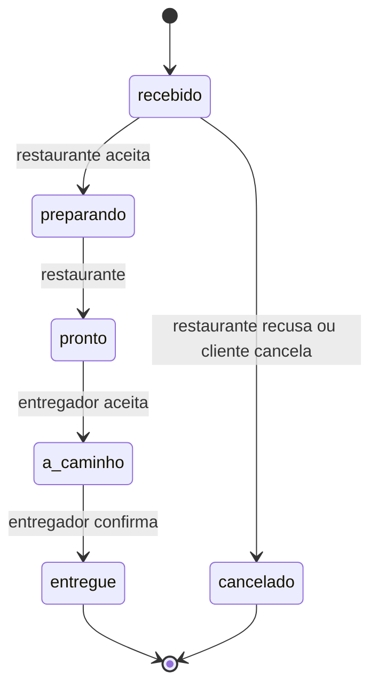

# Escopo, metodologia e requisitos

Autor: Thiago Bortoleto Xavier · RGM 41142969

Esta é a revisão do planejamento da PIT I, feita em ciclo de melhoria contínua (Kaizen). O projeto original descrevia só a metodologia ágil. Agora o escopo, os requisitos e as regras de negócio estão definidos.

## 1. Escopo
**Problema:** uma empresa precisa de um aplicativo de entrega de comida e de uma forma ágil de desenvolvê-lo.

**Solução:** o **Entrega Fácil**, uma aplicação web instalável (PWA) que liga três perfis:

| Perfil | O que faz |
|---|---|
| Cliente | Vê o cardápio sem precisar de conta, personaliza itens, monta a sacola, entra só ao finalizar e acompanha o pedido |
| Restaurante | Gerencia o cardápio, recebe pedidos, aceita ou recusa e libera para entrega |
| Entregador | Vê pedidos prontos, aceita a entrega e confirma a conclusão |

**Fora do escopo desta versão:** pagamento online real (é simulado), mapa e rastreio por GPS, avaliações, edição das opções de personalização pelo restaurante.

## 2. Mudanças em relação à PIT I (Kaizen)
| Antes | Agora | Motivo |
|---|---|---|
| Só descrição de metodologia | Requisitos, UML, IHC e banco documentados | Dar base para codificar e testar |
| Login obrigatório para ver o app | Cardápio aberto, login só no checkout | Menos atrito na compra |
| Pedido simples (item e quantidade) | Itens personalizáveis (carne, adicionais, retiradas) | Hambúrguer é vendido assim |
| Backend em um arquivo | MVC (Model, View, Controller) | Padrão pedido na disciplina |

## 3. Metodologia: Scrum
- **Papéis:** Product Owner (prioriza), Scrum Master (remove impedimentos), time de desenvolvimento.
- **Cerimônias:** planejamento da sprint, daily, revisão e retrospectiva.
- **Artefatos:** Product Backlog, Sprint Backlog e incremento funcional.
- **Quadro:** Kanban (Trello ou GitHub Projects) com as colunas A fazer, Fazendo, Teste e Pronto.

### Product Backlog
| # | História de usuário | Prioridade | Sprint |
|---|---|---|---|
| 1 | Como usuário, quero me cadastrar e entrar | Alta | 1 |
| 2 | Como cliente, quero ver restaurantes e cardápio | Alta | 1 |
| 3 | Como restaurante, quero gerenciar o cardápio | Alta | 1 |
| 4 | Como cliente, quero personalizar o item (carne, adicionais, retiradas) | Alta | 2 |
| 5 | Como cliente, quero montar a sacola e finalizar o pedido | Alta | 2 |
| 6 | Como restaurante, quero aceitar o pedido e atualizar o status | Alta | 2 |
| 7 | Como entregador, quero aceitar e concluir entregas | Alta | 3 |
| 8 | Como cliente, quero acompanhar o pedido e cancelar enquanto "recebido" | Média | 3 |
| 9 | Como usuário, quero instalar o app no celular (PWA) | Média | 3 |
| 10 | Pagamento real, mapa, avaliações | Baixa | Futuro |

### Sprints
1. **Sprint 1:** autenticação, restaurantes e cardápio.
2. **Sprint 2:** personalização, sacola, pedido e fluxo do restaurante.
3. **Sprint 3:** entregador, PWA, testes, deploy, testes com usuários e correções.

## 4. Requisitos funcionais
| ID | Requisito |
|---|---|
| RF01 | Cadastro e login com 3 perfis |
| RF02 | Listar restaurantes e cardápio sem login |
| RF03 | O restaurante cria e remove produtos |
| RF04 | O cliente personaliza o item: quantidade de carnes, adicionais, retiradas, escolhas (ponto, pão) e observação |
| RF05 | O cliente monta a sacola e finaliza informando endereço e forma de pagamento (Pix, cartão ou dinheiro com troco) |
| RF06 | O sistema calcula subtotal, taxa de entrega e total |
| RF07 | O restaurante aceita, recusa e marca o pedido como pronto |
| RF08 | O entregador aceita pedidos prontos e confirma a entrega |
| RF09 | O cliente acompanha o status em linha do tempo e cancela enquanto "recebido" |
| RF10 | O app funciona como PWA instalável |

## 5. Requisitos não funcionais
| ID | Requisito |
|---|---|
| RNF01 | Senhas com hash bcrypt. Autenticação JWT (12 h) |
| RNF02 | Autorização por perfil e por dono do recurso |
| RNF03 | O preço é sempre recalculado no servidor |
| RNF04 | Interface responsiva e instalável |
| RNF05 | Erros tratados: a API devolve JSON com mensagem e o código HTTP correto |
| RNF06 | Status atualizado a cada 5 s (polling) |
| RNF07 | Código no padrão MVC, com testes automatizados |

## 6. Regras de negócio
- RN01 Pedido só é aceito com subtotal maior ou igual ao mínimo do restaurante.
- RN02 O total é igual a subtotal mais taxa de entrega.
- RN03 O extra respeita `min` e `max`. A carne cobra só as unidades acima da inclusa.
- RN04 Em cada grupo de "escolha", exatamente uma opção vale. A primeira é a padrão.
- RN05 O cliente só cancela com o pedido em `recebido`.
- RN06 Só um entregador consegue aceitar cada pedido.
- RN07 O restaurante só mexe nos pedidos da própria casa.
- RN08 A sacola só guarda itens de um restaurante por vez.

## 7. Fluxo de status do pedido

