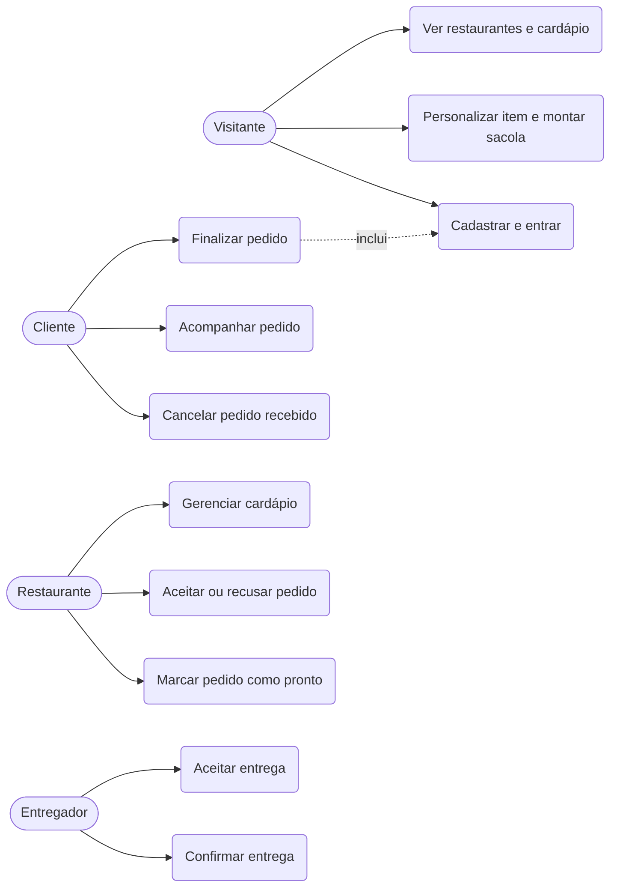
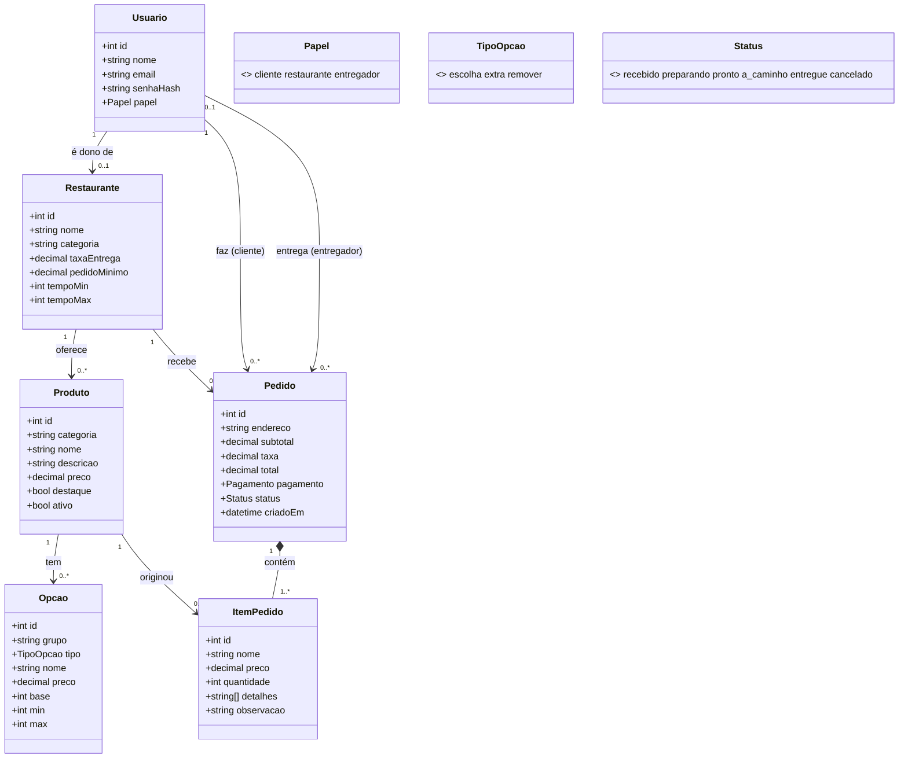
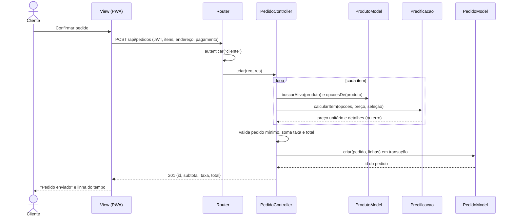
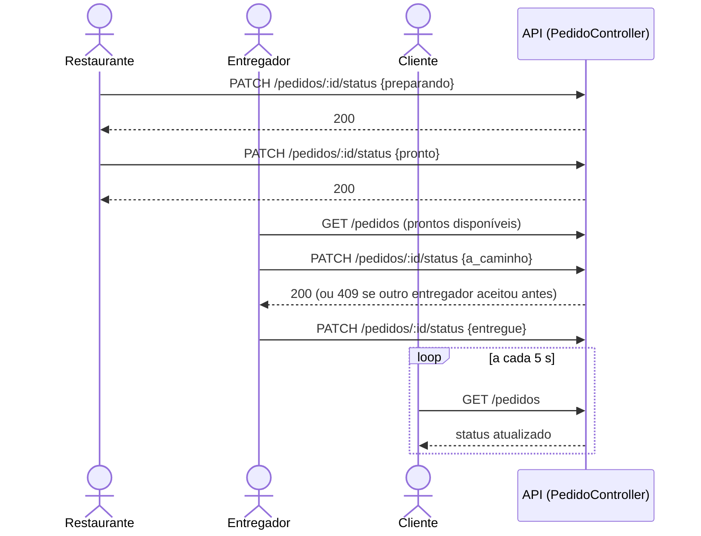
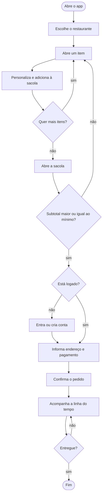

# Modelagem UML

Diagramas em Mermaid (GitHub renderiza automaticamente).

## 1. Casos de uso

O Cliente é um Visitante autenticado. O Finalizar pedido inclui o login quando ele ainda não foi feito.

## 2. Diagrama de classes (persistência)

## 3. Diagrama de sequência: finalizar pedido

## 4. Diagrama de sequência: preparo e entrega

## 5. Diagrama de atividades: jornada do cliente

