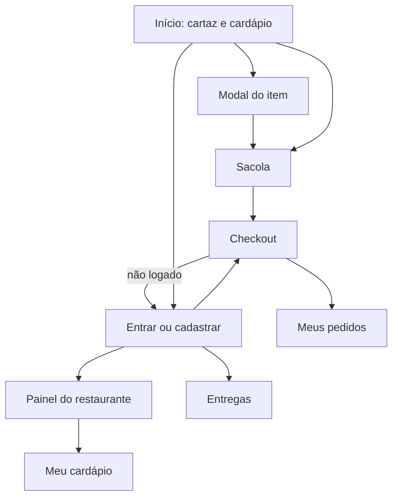
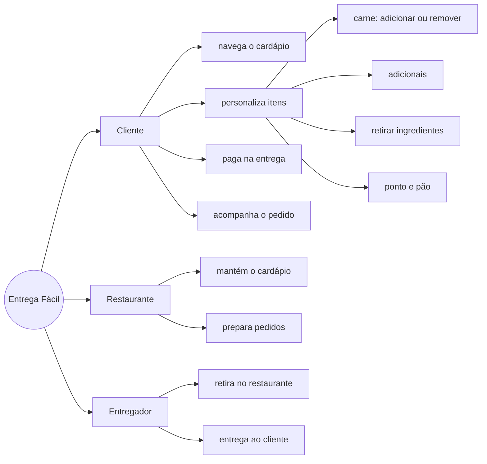

# IHC: interface humano-computador

## 1. Princípios aplicados (do material da disciplina)
| Princípio | Como aparece no app |
|---|---|
| Interface simples | Poucos elementos por tela, um botão principal em dourado por contexto |
| Consistência | Mesmos botões, steppers (− e +) e cartões em todo o app |
| Layout objetivo | Foto grande e marca no topo, depois categorias fixas e itens em ordem de importância |
| Cor e contraste | Fundo escuro, texto claro, dourado só para ação e preço |
| Tipografia com hierarquia | Fonte condensada em títulos de seção, fonte neutra no texto |
| O sistema comunica o que acontece | Avisos (toast) para cada ação, preço que atualiza ao vivo, linha do tempo do pedido |
| Padrões que reduzem esforço | Endereço lembrado, opção padrão em cada escolha, cardápio sem login |

## 2. Mapa de navegação

## 3. Mapa conceitual

## 4. Telas
| Tela | Elementos principais | Quem usa |
|---|---|---|
| Início (cartaz) | Foto de capa, nome da marca, tempo, taxa e pedido mínimo, botão "Ver cardápio", seletor de restaurante | Todos |
| Cardápio | Categorias fixas no topo, "Mais pedidos" em destaque, lista com foto e preço | Visitante, cliente |
| Modal do item | Foto, descrição, quantidade de carnes, escolhas (ponto, pão), adicionais, retiradas, observação, quantidade e botão com o total | Visitante, cliente |
| Sacola (gaveta lateral) | Itens com personalizações, steppers, subtotal, taxa, total, aviso de pedido mínimo | Visitante, cliente |
| Entrar e cadastrar | E-mail e senha, escolha do tipo de conta no cadastro, contas de demonstração | Todos |
| Checkout | Endereço, forma de pagamento (Pix, cartão, dinheiro com troco), resumo | Cliente |
| Meus pedidos | Cartão por pedido, linha do tempo, itens e personalizações, ação "Cancelar" | Cliente |
| Pedidos recebidos | Cartão por pedido com botões "Aceitar", "Recusar" e "Marcar como pronto" | Restaurante |
| Meu cardápio | Formulário de produto e lista com "Remover" | Restaurante |
| Entregas | Pedidos prontos, "Aceitar entrega" e "Confirmar entrega" | Entregador |

## 5. Mensagens de erro e de sistema
| Situação | Mensagem exibida |
|---|---|
| Login errado | "E-mail ou senha inválidos" |
| E-mail repetido | "E-mail já cadastrado" |
| Senha curta | "Senha deve ter ao menos 6 caracteres" |
| Sacola abaixo do mínimo | "Faltam R$ X para o pedido mínimo de R$ Y" (botão Finalizar bloqueado) |
| Endereço vazio | "Informe o endereço de entrega" |
| Escolheu duas opções do mesmo grupo | "Escolha apenas uma opção em ..." (a interface já impede) |
| Sessão vencida | "Sessão expirada. Entre novamente." |
| Pedido já aceito por outro entregador | "Pedido já foi aceito por outro entregador" |
| Transição não permitida | "Transição inválida: pronto -> entregue" |
| Sem internet | Página "Sem conexão" com botão "Tentar novamente" |
| Ação concluída | "Pedido #N enviado ao restaurante", "Status atualizado", "Produto adicionado" |

## 6. Protótipo
O protótipo evoluiu para a própria aplicação funcional (`frontend/`). As imagens de tela ficam em [`../situacao-3-testes/evidencias/`](../situacao-3-testes/evidencias/).

## 7. Acessibilidade e responsividade
- Layout pensado primeiro para celular, com colunas que se ajustam em telas largas.
- Botões de ação com no mínimo 32 px de área de toque.
- `aria-label` em botões só com ícone ou símbolo, `role="dialog"` nos modais e fechamento com Esc.
- Respeita `prefers-reduced-motion`.
