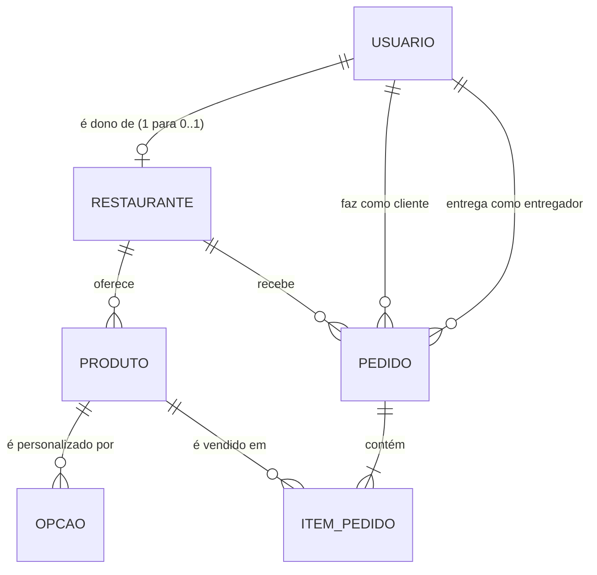

# Banco de dados: conceitual, lógico, físico e dicionário

## 1. Projeto conceitual
Entidades e relacionamentos (cardinalidades entre parênteses).

Regras que o modelo garante:
- Um usuário só é dono de um restaurante se o papel for `restaurante`.
- Todo pedido tem um cliente, um restaurante e ao menos um item. O entregador é preenchido só quando ele aceita a entrega.
- O produto é desativado (`ativo = 0`) e nunca apagado, para não quebrar o histórico de pedidos.

## 2. Projeto lógico (normalizado até a 3ª forma normal)
| Tabela | Chave primária | Chaves estrangeiras |
|---|---|---|
| `usuarios` | `id` | n/a |
| `restaurantes` | `id` | `usuario_id` para `usuarios` |
| `produtos` | `id` | `restaurante_id` para `restaurantes` |
| `opcoes` | `id` | `produto_id` para `produtos` |
| `pedidos` | `id` | `cliente_id` e `entregador_id` para `usuarios`; `restaurante_id` para `restaurantes` |
| `itens_pedido` | `id` | `pedido_id` para `pedidos`; `produto_id` para `produtos` |

**Normalização**
- **1FN:** todos os campos são atômicos. A lista de personalizações do item é guardada como texto JSON só para exibição histórica, e o cálculo do preço usa a tabela `opcoes`.
- **2FN:** todas as tabelas têm chave simples (`id`), então não há dependência parcial.
- **3FN:** nenhum atributo não chave depende de outro não chave. Exceções propositais, por histórico:
  - `itens_pedido.nome` e `itens_pedido.preco` copiam o produto na hora da compra. Se o restaurante mudar o preço depois, o pedido antigo continua correto.
  - `pedidos.total` é `subtotal + taxa`, gravado para não depender de recálculo.

## 3. Projeto físico
Script completo e executável: [`schema.sql`](schema.sql), escrito para **PostgreSQL**.

**Sobre o SGBD:** a aplicação roda com **SQLite** (módulo `node:sqlite`, já incluso no Node.js). Escolhi para a entrega por não exigir servidor, o que torna o teste e o deploy simples. O modelo e as restrições (`CHECK`, `FOREIGN KEY`, `UNIQUE`) são os mesmos do `schema.sql`. Migrar para PostgreSQL exige trocar apenas a camada de acesso em `backend/src/models/` e `backend/src/db.js`. O MVC isola o SQL nos Models, e é por isso que essa troca é localizada.

## 4. Dicionário de dados

### usuarios
| Coluna | Tipo | Nulo | Chave | Descrição / domínio |
|---|---|---|---|---|
| id | inteiro | não | PK | Identificador automático |
| nome | texto (120) | não | | Nome completo |
| email | texto (160) | não | UNIQUE | Login. Não repete |
| senha_hash | texto (100) | não | | Hash bcrypt. A senha nunca é guardada |
| papel | texto (12) | não | | `cliente`, `restaurante` ou `entregador` |

### restaurantes
| Coluna | Tipo | Nulo | Chave | Descrição / domínio |
|---|---|---|---|---|
| id | inteiro | não | PK | Identificador |
| usuario_id | inteiro | não | FK usuarios | Dono do restaurante |
| nome | texto (120) | não | | Nome fantasia |
| categoria | texto (60) | não | | Tipo de cozinha. Padrão `Variada` |
| descricao | texto (255) | não | | Texto de apresentação |
| imagem | texto (255) | sim | | Caminho da foto de capa |
| taxa_entrega | decimal(8,2) | não | | R$ de entrega, maior ou igual a 0 |
| pedido_minimo | decimal(8,2) | não | | R$ mínimo de subtotal, maior ou igual a 0 |
| tempo_min / tempo_max | inteiro | não | | Prazo estimado em minutos (`max >= min`) |

### produtos
| Coluna | Tipo | Nulo | Chave | Descrição / domínio |
|---|---|---|---|---|
| id | inteiro | não | PK | Identificador |
| restaurante_id | inteiro | não | FK restaurantes | Casa que vende |
| categoria | texto (60) | não | | Seção do cardápio (ex.: Hambúrgueres) |
| nome | texto (120) | não | | Nome do item |
| descricao | texto (255) | não | | Ingredientes e detalhes |
| preco | decimal(8,2) | não | | Preço base em R$, maior ou igual a 0 |
| imagem | texto (255) | sim | | Caminho da foto |
| destaque | 0 ou 1 | não | | 1 aparece em "Mais pedidos" |
| ativo | 0 ou 1 | não | | 0 significa removido do cardápio |

### opcoes
| Coluna | Tipo | Nulo | Chave | Descrição / domínio |
|---|---|---|---|---|
| id | inteiro | não | PK | Identificador |
| produto_id | inteiro | não | FK produtos | Item personalizado |
| grupo | texto (60) | não | | Agrupa opções (ex.: Ponto da carne) |
| tipo | texto (10) | não | | `escolha`: uma por grupo. `extra`: quantidade de `min` a `max`. `remover`: ingrediente retirado |
| nome | texto (120) | não | | Nome da opção |
| preco | decimal(8,2) | não | | R$ por unidade acima de `base` (extra) ou da escolha |
| base | inteiro | não | | Quantidade já inclusa no preço (ex.: 1 carne) |
| min / max | inteiro | não | | Limites de quantidade (`max >= min`) |

### pedidos
| Coluna | Tipo | Nulo | Chave | Descrição / domínio |
|---|---|---|---|---|
| id | inteiro | não | PK | Número do pedido |
| cliente_id | inteiro | não | FK usuarios | Quem pediu |
| restaurante_id | inteiro | não | FK restaurantes | Quem prepara |
| entregador_id | inteiro | sim | FK usuarios | Preenchido ao aceitar a entrega |
| endereco | texto (255) | não | | Endereço de entrega |
| subtotal | decimal(10,2) | não | | Soma dos itens |
| taxa | decimal(8,2) | não | | Taxa de entrega na data do pedido |
| total | decimal(10,2) | não | | `subtotal + taxa` |
| pagamento | texto (10) | não | | `pix`, `cartao` ou `dinheiro` (simulado) |
| troco_para | decimal(10,2) | sim | | Valor em dinheiro para cálculo de troco |
| status | texto (12) | não | | `recebido`, `preparando`, `pronto`, `a_caminho`, `entregue` ou `cancelado` |
| criado_em | data e hora | não | | Gravado automaticamente (UTC) |

### itens_pedido
| Coluna | Tipo | Nulo | Chave | Descrição / domínio |
|---|---|---|---|---|
| id | inteiro | não | PK | Identificador |
| pedido_id | inteiro | não | FK pedidos | Pedido a que pertence |
| produto_id | inteiro | não | FK produtos | Produto original |
| nome | texto (120) | não | | Cópia do nome na compra |
| preco | decimal(8,2) | não | | Preço unitário final (base mais personalizações) |
| quantidade | inteiro | não | | Maior que 0 (a API limita a 50) |
| detalhes | texto (JSON) | não | | Lista legível das personalizações |
| observacao | texto (200) | não | | Recado do cliente para a cozinha |
