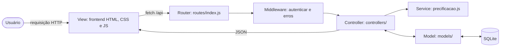

# Arquitetura MVC e tecnologias

## Stack
| Item | Escolha |
|---|---|
| Linguagem do back-end | JavaScript (Node.js 22.13 ou superior) |
| Framework web | Express 4 |
| Banco de dados | SQLite (`node:sqlite`). Script PostgreSQL em `../situacao-1-planejamento/schema.sql` |
| Autenticação | JWT (`jsonwebtoken`) e senhas com `bcryptjs` |
| Front-end | HTML, CSS e JavaScript puro, sem framework |
| PWA | `manifest.webmanifest` e service worker (`sw.js`) |
| Testes | `node:test`, nativo do Node.js |
| Modo de codificação | Tradicional |
| Hospedagem | Render (`render.yaml` na raiz) |

## Padrão MVC


| Camada | Pasta | Responsabilidade |
|---|---|---|
| **Model** | `backend/src/models/` | Único lugar que escreve SQL. Um arquivo por tabela: usuários, restaurantes, produtos e pedidos |
| **View** | `frontend/` | Telas (HTML, CSS, JS). Consome a API e desenha a interface |
| **Controller** | `backend/src/controllers/` | Regras de negócio e validações. Recebe a requisição, chama os Models e responde |
| Router | `backend/src/routes/index.js` | Liga cada rota ao controller e define quem pode acessar |
| Middleware | `backend/src/middleware/` | Autenticação JWT e tratamento central de erros |
| Service | `backend/src/services/precificacao.js` | Cálculo do preço do item personalizado |
| Config | `backend/src/config.js` | Constantes de negócio: papéis, pagamentos e transições de status |

## Estrutura de pastas
```
backend/
  src/
    app.js              monta a aplicação
    server.js           inicia o servidor
    db.js               esquema e dados de demonstração
    config.js
    routes/index.js
    middleware/         auth.js, erros.js
    controllers/        authController, cardapioController, pedidoController
    models/             usuarioModel, restauranteModel, produtoModel, pedidoModel
    services/           precificacao.js
  test/                 testes automatizados
frontend/               View (PWA)
docs/                   documentação por situação
```

## Tratamento de erros
- Os controllers lançam `HttpError(status, mensagem)`.
- O middleware `tratarErros` converte tudo em JSON: `{ "erro": "mensagem" }` com o código correto (400, 401, 403, 404, 409, 413, 500).
- JSON malformado devolve 400, rota inexistente da API devolve 404, e erro inesperado devolve 500 sem expor detalhes.
- O front-end mostra a mensagem num aviso e bloqueia ações inválidas (por exemplo, o botão Finalizar fica desabilitado abaixo do pedido mínimo).

## Segurança
- Senhas guardadas só como hash bcrypt.
- Preço e total calculados no servidor. O cliente não consegue alterá-los.
- SQL sempre parametrizado, sem concatenar entrada do usuário.
- Texto do usuário é escapado no front-end contra XSS.
- Autorização por perfil e por dono do recurso (ex.: restaurante só mexe nos pedidos da própria casa).
- Aceite de entrega atômico (`UPDATE ... WHERE status = 'pronto'`), então dois entregadores não pegam o mesmo pedido.

## API
| Método | Rota | Acesso |
|---|---|---|
| POST | `/api/auth/register` e `/api/auth/login` | Público |
| GET | `/api/restaurantes` e `/api/restaurantes/:id/produtos` | Público |
| POST e DELETE | `/api/produtos` e `/api/produtos/:id` | Restaurante |
| POST | `/api/pedidos` | Cliente |
| GET | `/api/pedidos` | Autenticado (filtrado por perfil) |
| PATCH | `/api/pedidos/:id/status` | Autenticado (transições validadas por perfil) |
| GET | `/api/saude` | Público |

## Testes automatizados
Rodar: `cd backend && npm test` (23 testes).

| Arquivo | O que cobre |
|---|---|
| `test/api.test.js` | Fluxo completo pedido, preparo e entrega. Permissões. Personalização. Pedido mínimo. CRUD de produto |
| `test/precificacao.test.js` | Testes unitários do cálculo de preço, limites e arredondamento |
| `test/erros-e-pwa.test.js` | JSON inválido, 404, token inválido, validação de cadastro, e arquivos do PWA (manifest, ícones, service worker) |
